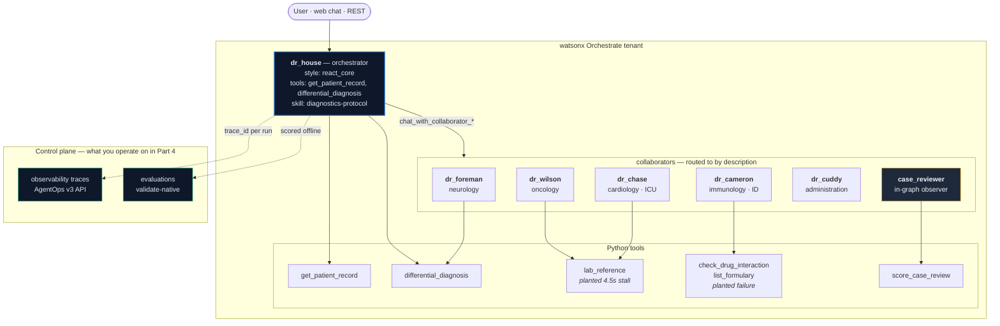

# IFSA workshop

## Building, routing, testing and operating a multi-agent team on IBM watsonx Orchestrate - entirely from IBM Bob IDE

### What you actually have

This lab assumes **exactly three things** and nothing else:

1. **Bob** (the agentic IDE) — running on your laptop
2. The **`watsonx-orchestrate` skill**, installed into Bob
3. **A watsonx Orchestrate instance** — your own Trial verion (see [README.md](../README.md#Dependencies))


Many parts below are built by **prompting Bob**, and Bob uses the skill to know which `orchestrate` commands are
real. That is the point of the lab: the skill is what turns a general-purpose coding agent
into something that can ship an agentic deployment.

### What you build

The **Princeton-Plainsboro diagnostics department** — Dr House and his team, as a live
multi-agent system on watsonx Orchestrate.



Seven agents, six tools, two agent skills. Dr House takes a case, pulls the chart, and
**calls the colleague who owns the finding** — that delegation is the thing you will watch,
measure and debug for the rest of the lab.

> **Why House M.D.?** Because everyone in the room already knows the cast. Nobody has to
> learn a fictional domain to follow a routing decision — you already know that a seizure
> goes to Foreman and a lawsuit goes to Cuddy. The medicine is synthetic and deliberately
> shallow; the orchestration is real.

### The four parts

| Part | You do | Time |
|------|--------|------|
| **[Part 1 — Build](01-lab-multiagent-orchestration.md)** | Build the team from nothing by prompting Bob: tools, an agent skill, five specialists, an orchestrator. Import, deploy, and **watch the routing fail, then fix it**. Export everything to your laptop and prove you can restore it. | ~60 min |
| **[Part 2 — Test & evaluate](02-lab-test-evaluate.md)** | Single-turn and multi-turn testing through Bob. A repeatable test suite. Add the in-graph **observer** agent. Run the wxO **evaluations** framework. Have Bob write you an **HTML5 evaluation report**. | ~50 min |
| **[Part 3 — Embed in a web app](03-lab-webchat-embed.md)** | Retrieve the embed credentials for `dr_house` from the watsonx Orchestrate console, place them in the Next.js app in [`ppth-web/`](ppth-web/), allow `localhost` as an embed origin, and consult Dr House from a web page. | ~20 min |
| **[Part 4 — Operate](04-extra-lab-control-plane.md)** *extra* | The control plane: what wxO captures **natively vs what you must derive**. Search and read a trace to diagnose latency. Session-level **cost and token accounting**. Build **dashboards** for error rate, tail latency and tool-call success. Inspect the native quality scores. Generate the CLI **embedded web chat** snippet. **Tear everything down.** | ~60 min |

Each part stands on the previous one. Part 1 is mandatory and every later part runs against
the team it deploys. Part 3 only needs the deployed `dr_house`, so it can be done straight
after Part 1. Part 4 reuses the test suite and observer from Part 2. Parts 2 to 4 can be run
on consecutive days against the same deployed team.

**Part 4 is optional extra material.** It is the most operational part: it is where you
find out which numbers the platform gives you and which you are on the hook to compute.
Skip it if time is short, but still run its teardown step (Step 8) when you finish.

### Pre-flight

**1. Bob + the skill.** Install the `watsonx-orchestrate` skill into Bob from the CE Bob
Marketplace. Confirm Bob can see it — ask it:

```text
Which skills do you have available? Show me what the watsonx-orchestrate skill covers.
```

Bob should describe the wxO agent/tool/flow/skill lifecycle. If it cannot, stop and fix the
skill install — nothing else in this lab will work.

**2. Your wxO instance.** From your watsonx Orchestrate instance, collect two values:

- the **API service URL**, the one containing `/instances/<id>` — *not* the console URL
- an **API key** for that instance

Find these values in **watsonx Orchestrate** -> `your_initials` (top right corner) -> **Settings** -> **API Details**

Put them in your shell, never in a file you commit:

```bash
export WXO_INSTANCE_URL="https://api.<region>.watson-orchestrate.cloud.ibm.com/instances/<INSTANCE_ID>"
export WXO_API_KEY="<your-api-key>"
export WXO_ENV_NAME="houselab"
```

**3. Set up the CLI.**:

Install the watsonx Orchestrate ADK
```bash
# Install watsonx Orchestrate ADK library
pip install --upgrade ibm-watsonx-orchestrate
# Verify watsonx Orchestrate has been successully installed
orchestrate --version
```

Then create your environment

```bash
# Create your env
orchestrate env add -n $WXO_ENV_NAME -u $WXO_INSTANCE_URL
# Activate your env
orchestrate env activate $WXO_ENV_NAME --api-key $WXO_API_KEY
# Check available agents in your env
orchestrate agents list
```

Test if Bob can reach the environment too.

```text
I've set up the watsonx Orchestrate environment called 'houselab' in terminal, run 'orchestrate agents list' to return list of available agents and also name the default model.
```

You are ready when Bob reports a working `orchestrate agents list` and names your default
model. This lab was authored against **`groq/openai/gpt-oss-120b`**; if your tenant offers
a different default, use that and expect different token counts.

### Ground rules

- **`orchestrate ... import` is upsert-by-name.** If your instance already has an agent
  called `dr_house`, importing this lab's `dr_house` **overwrites it, silently, with no
  backup**. On a shared instance, have Bob prefix every resource (`fde01_dr_house`) or
  export what is already there first. This is not hypothetical — it happened while
  authoring this lab.
- **Everything here is synthetic.** The patients, charts, formulary and laboratory ranges
  are fictional and must never be used clinically. Every agent is instructed to say so.
- **Clean up when you finish.** Part 4 ends with a teardown prompt (Step 8). If you skip
  Part 4, run [`reference-solution/delete-all.sh`](reference-solution/delete-all.sh) or ask
  Bob to remove what you created.

### Reference solution

[`reference-solution/`](reference-solution/) is the **complete, working project** exactly as
it was built and validated while authoring this lab, including the captured evidence:

```
reference-solution/
├── agents/            7 agent YAMLs
├── tools/             5 Python tool files (6 tools)
├── skills/            diagnostics-protocol · case-review-rubric
├── telemetry/         wxo_client.py · run_suite.py · analyze.py · make_report.py · rate_card.json
├── test/
│   ├── questions.json         the 8 lab questions + expectations
│   └── results/
│       ├── session.json               captured runs
│       ├── metrics.json               computed metrics
│       ├── evaluation-report.html     the HTML5 report
│       ├── before-routing-fix/        the failing baseline (5/9 routing)
│       └── example_trace_with_judge_score.json
├── eval/out/          a real `validate-native` run
├── webchat/index.html the standalone embedded web-chat page (Part 4 Step 7)
├── import-all.sh · delete-all.sh
└── README.md
```

**Use it as a checkpoint, not a shortcut.** The learning is in prompting Bob to produce
these artifacts and debugging what comes back. Look here when you are stuck, when you want
to compare your agent's instructions against one that routes correctly, or when you want to
see what the captured telemetry is supposed to look like.
